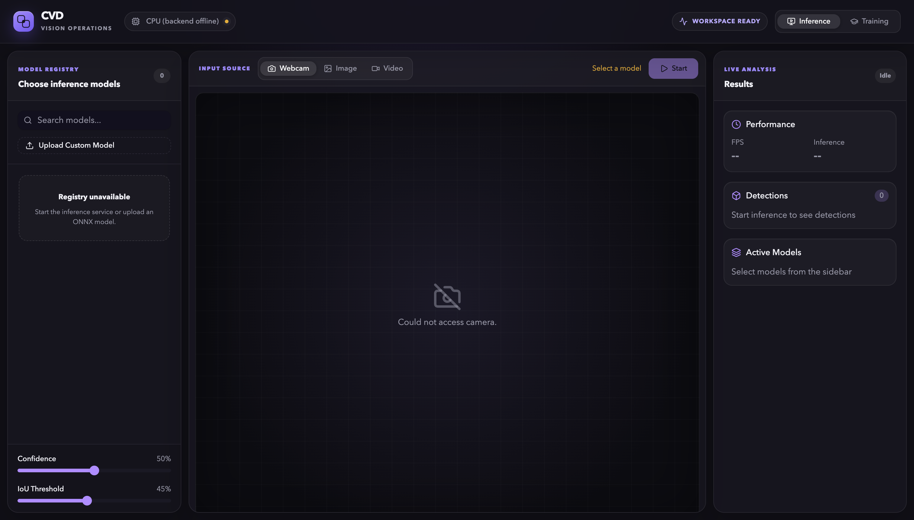
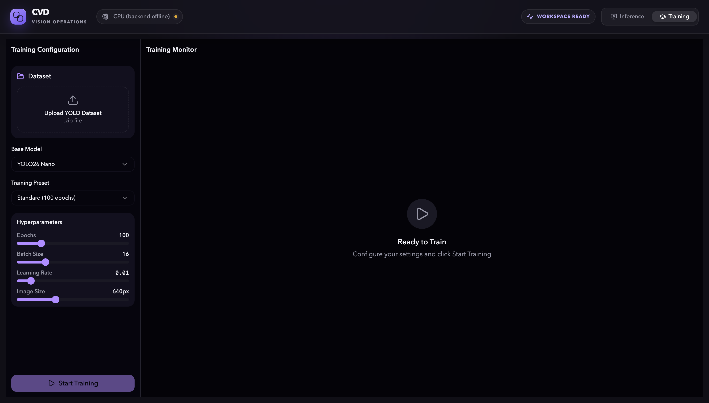

# CVD

CVD is a local computer-vision workspace. It provides a React dashboard and a Python inference service. You can run detection, segmentation, pose, classification, and oriented-box models. You can also upload a YOLO data set and start a training job.

CVD listens on the local computer by default. It does not require an API key.

## Screenshots

<!-- SCREENSHOTS_START -->
### Inference workspace



### Training workspace


<!-- SCREENSHOTS_END -->

## Main functions

- Run inference on an image, video, or camera stream.
- Use an included YOLO11 Nano ONNX model.
- Load a compatible PyTorch or ONNX model.
- Select an available compute device.
- Review detections and performance data.
- Upload a YOLO-format data set.
- Start and monitor a local training job.

## Security model

CVD is a local development tool. It has no user authentication. The start script binds the API to `127.0.0.1` by default.

Do not expose the API to an untrusted network. If you set `CVD_HOST` to a non-local address, put CVD behind an authenticated reverse proxy.

CVD limits model uploads to 100 MB. It limits data-set archives to 2 GB. It also checks ZIP paths and extracted size before extraction.

## Requirements

- Python 3.11 or later
- Node.js 20.19 or later
- npm
- 8 GB of free memory for basic CPU inference
- More memory for large models or training

A CUDA-capable GPU is optional. Apple Silicon acceleration is optional.

## Included model

The repository includes `models/yolo11n.onnx`. This small model lets you run detection after setup.

The repository does not include the local Python environment, training output, data sets, or other exported models. These items are large generated files.

Ultralytics can download a selected built-in model when you load it. This action requires internet access. Review the model license before you redistribute a model.

## Install CVD

1. Clone the repository.
2. Create a Python environment.
3. Install the Python packages.
4. Install the web packages.

```bash
cd backend
python3 -m venv .venv
source .venv/bin/activate
python -m pip install --upgrade pip
python -m pip install -r requirements.txt

cd ../frontend
npm ci
```

On Windows PowerShell, activate the Python environment with this command:

```powershell
.venv\Scripts\Activate.ps1
```

## Start CVD

Run the start script with the Python environment active:

```bash
python run.py
```

Open `http://127.0.0.1:5173` on the same computer.

The API documentation is at `http://127.0.0.1:8000/docs`.

## Change the local ports

Set these optional environment variables before you start CVD:

```bash
export CVD_BACKEND_PORT=8000
export CVD_FRONTEND_PORT=5173
```

Keep `CVD_HOST=127.0.0.1` unless you add access control.

## Add a model

Use one of these methods:

1. Put a `.pt` or `.onnx` file in `models/`.
2. Start CVD.
3. Select the model in the dashboard.

You can also use the upload control. Do not upload a model from an untrusted source. Model formats can contain complex serialized data.

## Add a data set

1. Prepare a YOLO-format ZIP file.
2. Include a `data.yaml`, `dataset.yaml`, or `data.yml` file.
3. Use relative image paths in the YAML file.
4. Upload the ZIP file in the training view.

Do not upload private images to a shared CVD instance.

## Verify a change

Run the web checks:

```bash
cd frontend
npm run lint
npm run build
```

Run the Python syntax check:

```bash
python -m compileall -q backend/app run.py
```

Run the upload-safety tests in the configured Python environment:

```bash
cd backend
python -m unittest discover -s tests
```

## Project structure

```text
backend/app/    FastAPI routes and computer-vision services
frontend/src/  React dashboard
models/        Local model files
datasets/      Local training data; Git ignores this directory
runs/          Local training output; Git ignores this directory
run.py         Local start script
```

## Security

Read [SECURITY.md](SECURITY.md) before you report a vulnerability. Do not include a private model, data set, access token, or image in a public issue.

## License

CVD uses the [PolyForm Noncommercial License 1.0.0](LICENSE.md). It is source-available software. It is not open source under the OSI definition. Business use requires written permission from One Man Labs.

Third-party packages and models have separate terms. Read [THIRD_PARTY_NOTICES.md](THIRD_PARTY_NOTICES.md).
